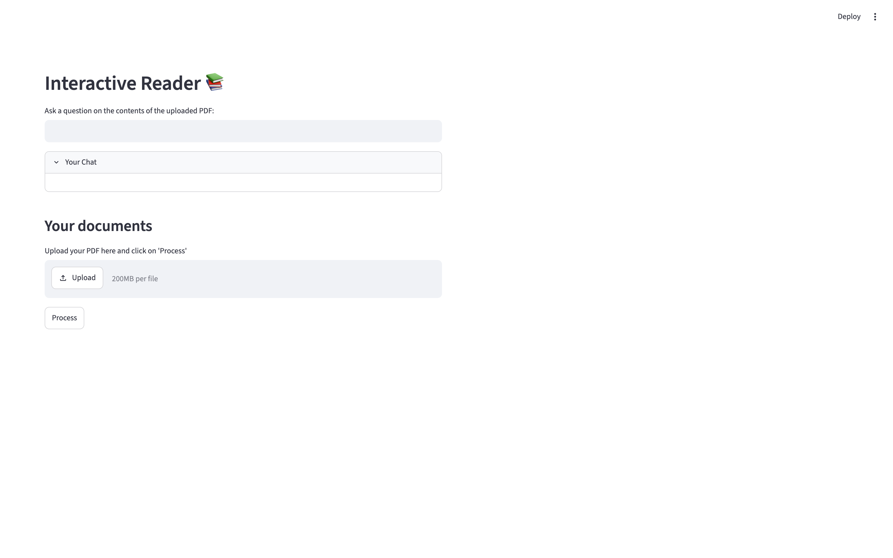
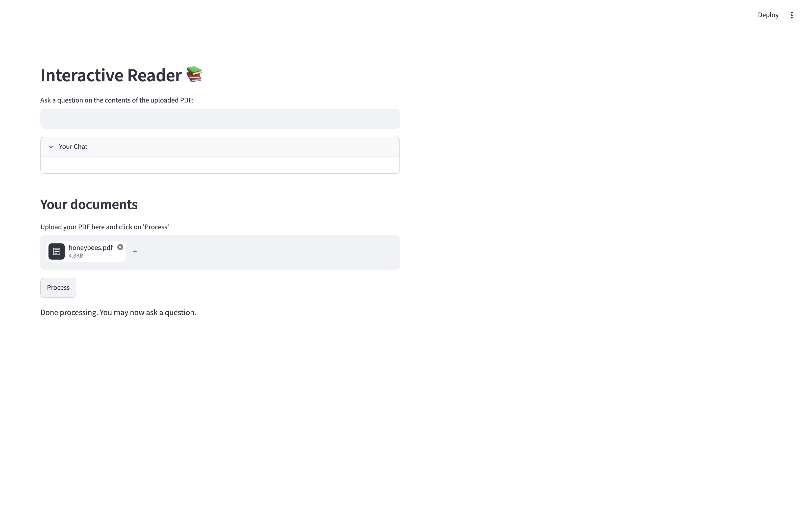
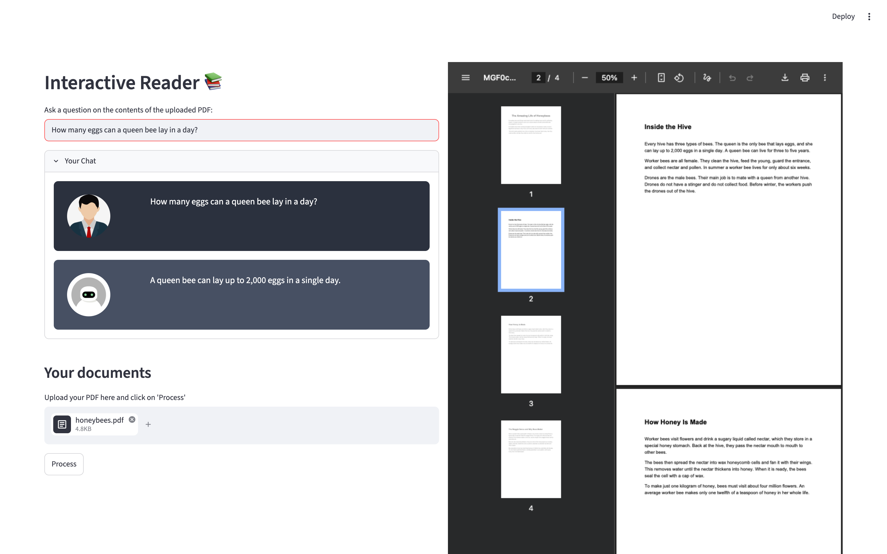
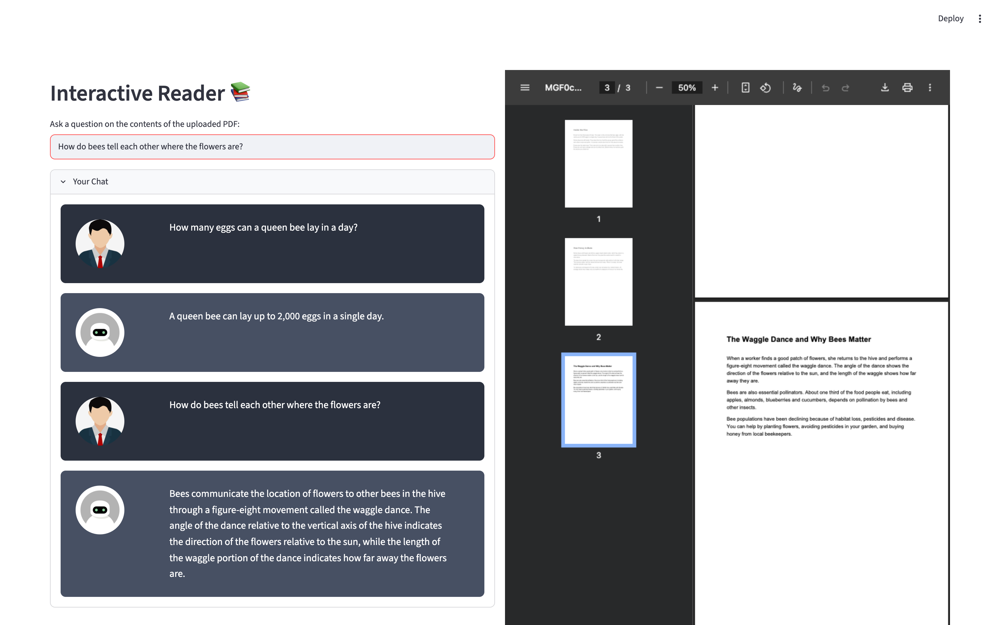

# Interactive PDF Reader using LangChain and Streamlit

Upload a PDF, ask questions about it in plain English, and get answers in a chat window. Next to the chat, the app shows the PDF pages the answer came from, so you can check the source yourself.

Everything runs **locally and for free**: the language model runs through [Ollama](https://ollama.com), and the embeddings run on your CPU with Hugging Face. No API key and no token limits.

## Demo

The demo uses [demo/honeybees.pdf](demo/honeybees.pdf), a short 4-page guide to honeybees.

### 1. Start the app

The page has a question box, a chat area, and an upload section.



### 2. Upload a PDF and click **Process**

The app splits the PDF into chunks, embeds them and builds a searchable index.



### 3. Ask a question

The answer appears in the chat. The PDF viewer on the right opens at the page the answer came from (here, page 2 of the PDF).

> **Q:** How many eggs can a queen bee lay in a day?
> **A:** A queen bee can lay up to 2,000 eggs in a single day.



### 4. Keep chatting

Follow-up questions keep the chat history. The preview jumps to the page that matches the new answer.

> **Q:** How do bees tell each other where the flowers are?
> **A:** Bees communicate the location of flowers to other bees in the hive through a figure-eight movement called the waggle dance. The angle of the dance relative to the vertical axis of the hive indicates the direction of the flowers relative to the sun, while the length of the waggle portion of the dance indicates how far away the flowers are.



## How it works

1. **Load:** `PyPDFLoader` reads the uploaded PDF page by page.
2. **Embed:** each page is embedded with `thenlper/gte-small` (Hugging Face, runs on CPU).
3. **Store:** the embeddings go into an in-memory [Chroma](https://www.trychroma.com) vector store.
4. **Retrieve and answer:** a `ConversationalRetrievalChain` finds the 2 most relevant chunks and passes them, with the chat history, to a local LLM (`qwen2.5:7b` via Ollama).
5. **Show the source:** the page number of the best match is used to display the surrounding PDF pages in the viewer.

## Getting started

### Prerequisites

- Python 3.10 or newer
- [Ollama](https://ollama.com) installed. A Mac with 16 GB of RAM runs `qwen2.5:7b` comfortably; on 8 GB, use a smaller model such as `llama3.2:3b`.

### Install

```bash
pip install streamlit python-dotenv PyPDF2 \
    langchain langchain-classic langchain-community \
    langchain-huggingface langchain-chroma langchain-ollama \
    sentence-transformers
```

### Download the model and start Ollama

```bash
ollama pull qwen2.5:7b
ollama serve          # skip if the Ollama app is already running
```

### Run the app

```bash
streamlit run app.py
```

Open the URL Streamlit prints (usually http://localhost:8501), upload a PDF, click **Process**, then ask a question. Try it with the sample file in [demo/honeybees.pdf](demo/honeybees.pdf).

## Choosing a different model

The model is set in `process_file` in [app.py](app.py):

```python
ChatOllama(model="qwen2.5:7b", temperature=0.3)
```

Change the model name to any model you have pulled with `ollama pull` (for example `llama3.2:3b` for a smaller machine, or `qwen2.5:14b` for better reasoning).

## Project structure

| File | Purpose |
| --- | --- |
| [app.py](app.py) | Streamlit app: PDF processing, retrieval chain and chat UI |
| [htmlTemplates.py](htmlTemplates.py) | CSS and HTML templates for the chat messages |
| [demo/](demo) | Sample PDF and the screenshots shown above |

## Troubleshooting

- **`ConnectError: [Errno 61] Connection refused`**: Ollama is not running. Start it with `ollama serve`.
- **`model not found`**: pull the model first with `ollama pull qwen2.5:7b`.
- **Nothing happens after a question**: upload a PDF and click **Process** first.
- **`embeddings.position_ids | UNEXPECTED` in the terminal**: harmless message from loading the embedding model. You can ignore it.
